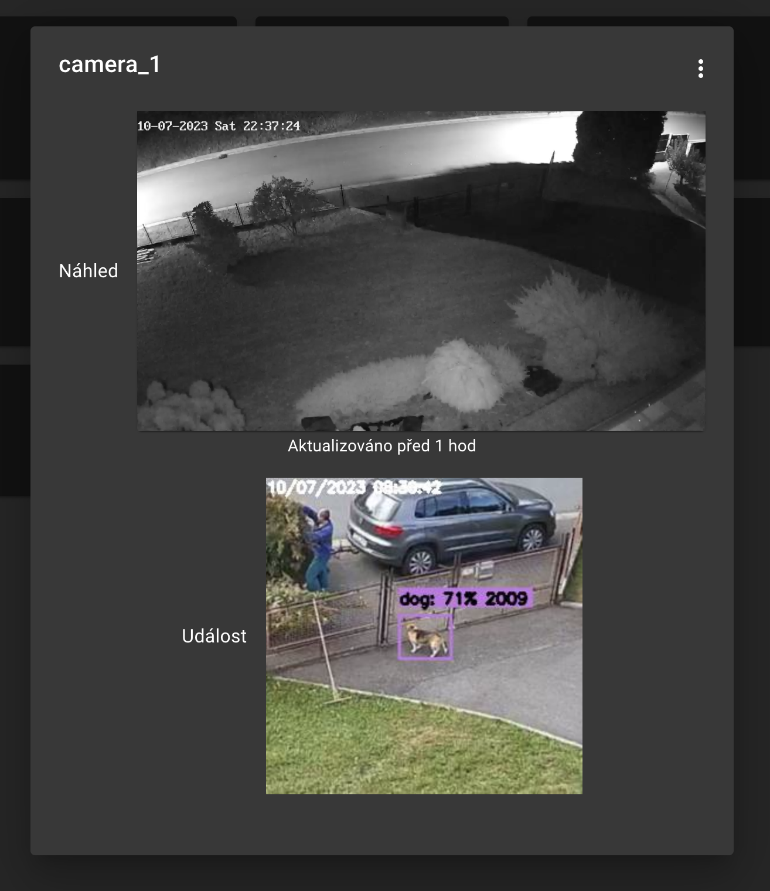
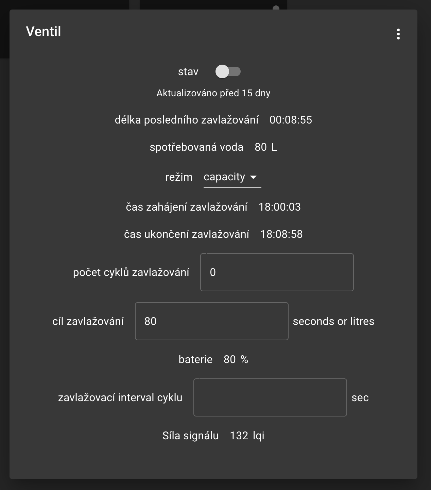
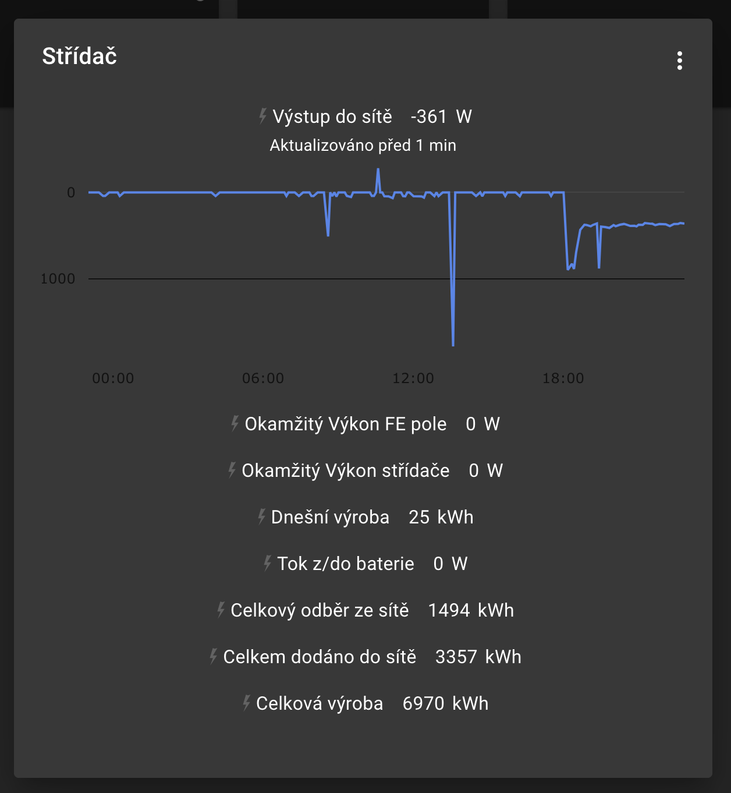
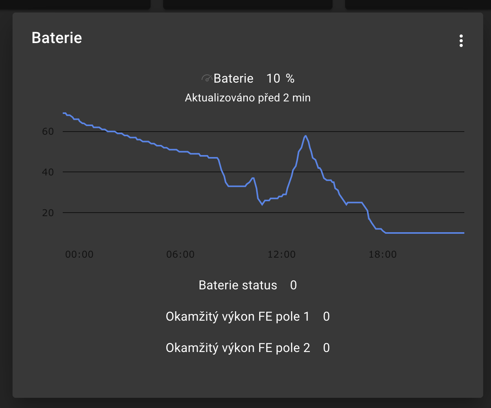

# IOT-Platform-integration

Repository contains bridges, integrations and bots written in Deno for [IoT Platform](https://github.com/founek2/IOT-Platform). It is used to integrate other HW devices which do not support direct connection thus allowing to connect ideally all of your devices to a single platform.

IoT Platform currently does not support any kinds of plugins, so integrations is done via this project - it emulates every device acting as a bridge for communication.

## How to run it

Define whole integration via yaml file. [example.yaml](./example.yaml) contains example configuration for all type of devices and bridges available.

```bash
# Bootstrap config
cp example.yaml config.yaml

# customize all you want
vim config.yaml

# run it
docker run -v ./data:/app/local-storage ./config.yaml:/config.yaml docker-registry.iotdomu.cz/iot-platform/integration
```

## Bridges

Exposing of all devices.

- Frigate (NVR) - integrate all your cameras, show current feed and events (snapshots)
- Zigbee2mqtt - integrate all your Zigbee devices
- Matter - integrate devices commissioned on a Matter Server
- Twilio - send sms message as reaction to Mqtt message

### Matter

Configure the `matter` bridge as shown in [example.yaml](./example.yaml). Its
`matterUrl` defaults to `ws://192.168.25.5:5580/ws`. The Matter Server must
remain running and store its fabric and Thread credentials persistently. Its
WebSocket API is privileged; restrict access to trusted clients and use a
secure network.

The bridge creates an IoT pairing device with the configured bridge ID and one
IoT device per Matter node, named `<bridge ID>-matter-<node ID>`. Pair these
devices with the IoT Platform like other integrations. Existing Matter nodes are
discovered automatically; additions, removals, availability and updates are
followed while connected. The bridge reconnects and reloads nodes after a server
disconnect. Matter node IDs can change if a device is decommissioned and paired
again.

To commission a new Thread device, configure the Thread dataset on Matter Server
first, enable Bluetooth there, and put the device in pairing mode. On the IoT
pairing device, set **Matter pairing code** to the manual code or `MT:` QR
payload. **Pairing status** reports progress or failure. For Wi-Fi devices,
configure Wi-Fi credentials on Matter Server first. The bridge does not publish
the code as a property value or log it, and ignores retained code messages.
Pairing codes still pass through the IoT Platform and MQTT broker: protect their
traffic, logs, access and storage; do not retain the command message.

Each Matter endpoint becomes an IoT node. Matter Server supplies the actual
attribute paths and accepted commands, while the standard Matter data model
supplies their names, types, enum values and access rights. Application-cluster
attributes are exposed from those definitions, along with power-source
attributes with known scalar, bitmap, array or structure types. Writable
attributes can be set; structured values use JSON and bitmaps use their numeric
value. Advertised commands are
available as string properties accepting a JSON object with the command's
Matter field names (use `{}` for a command without arguments). On/off and
brightness also have dedicated controls. Observed standard events, such as
button presses, are exposed as non-retained JSON event properties; the first
event of a new type creates its property.

Some unit conversions are specified by Matter rather than described by the
device and are applied separately; other values remain in their raw Matter
encoding. The model describes standard possibilities,
so a device may reject a particular enum value or command parameter. Unknown
vendor-specific clusters, system/security clusters, secret or fabric-scoped
fields, and binary attributes are not exposed. Commands containing model-marked
secrets are excluded, and atomic writes require Matter Server schema 15. Protect
MQTT traffic and logs; generic command payloads must not contain secrets.
Attribute values and events come from Matter Server's subscriptions, which
must not be disabled.

### Zigbee2mqtt

The bridge creates an IoT pairing device with the configured bridge ID and name,
separate from the Zigbee devices. Pair it with the IoT Platform and turn on
**Allow joining** to permit devices to join for 254 seconds; turn it off to stop
early. The switch reflects Zigbee2MQTT's reported state, including changes made
elsewhere and automatic expiry. The control device is disconnected when
Zigbee2MQTT is unavailable. Initial state synchronization requires MQTT retained
messages: keep Zigbee2MQTT's `mqtt.force_disable_retain` disabled and use a
broker that supports retained messages.

#### Device rebuilds

Changed Zigbee2mqtt device lists trigger a complete rebuild of the IoT device
instances. Devices initialize in parallel within each rebuild, while property
setup remains sequential within each device. Rebuilds run sequentially, including
disconnecting the previous clients, so multiple device-list updates cannot create
competing MQTT clients for the same device. Identical lists are skipped after a
successful rebuild. Failed rebuilds wait for all device initializations to settle
before they are logged and their partially initialized clients are disconnected;
a subsequent device-list update can retry the rebuild. Shutdown skips queued
rebuilds and waits for an active rebuild before disconnecting all clients.

## Devices

- Sony bravia TV
  - turn on/off
  - display custom html website
  - change volume
- Samsung TV (Tizen)
  - turn on/off
  - get/set volume
  - get/set mute
- Intex whirlpool - integrated via TCP connection to ESP display
  - current and target temperate
  - control: heating, bubbles, nozzles, filtration
- USSPA whirpool - custom http cloud API (custom API)
  - filtration, bubbles, temperature, pumps
- Solax inverter - integrated via Solax Cloud service, since gen X3 does not allow reading of MQTT messages (before it was just plain JSON)
  - Reading of all available values
- Yamaha reciever - [API spec](./_media/yamaha_API_spec.pdf)
  - turn on/off
  - change input
  - change volume
- Prusa 3D printer
- sms

## Docker installation

Docker compose mapping:

```yaml
# Required for UDP/ICMP sockets to work properly - used for Yamaha, Tizen
network_mode: host
```

## Examples



> Image shows integrated single camera via Frigate



> Image shows integration for Zigbee water valve <https://www.zigbee2mqtt.io/devices/QT06_1.html>

|                                   Solax inverter                                    |                                        Solax baterry                                        |
| :---------------------------------------------------------------------------------: | :-----------------------------------------------------------------------------------------: |
|  |  |

> Integration for Solax X3
